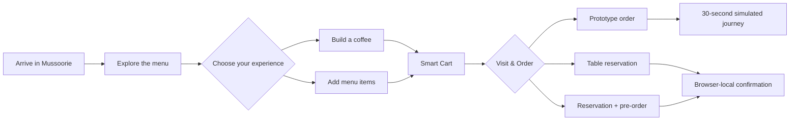
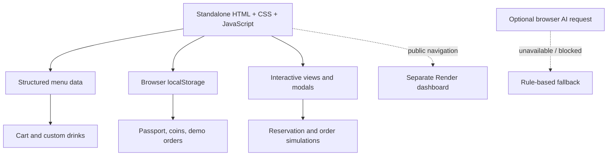

<div align="center">

# MIST <span style="color:#A66A47">&</span> MUG

### *Come in. It's cold outside.*

**A digital café above the ordinary.**  
A Mussoorie-inspired experience where coffee, weather, personalisation, and playful discovery meet.

[**ENTER THE CAFÉ**](https://mist-and-mug.onrender.com/) &nbsp; · &nbsp; [**EXPLORE THE DASHBOARD**](https://mist-mug-dashboard.onrender.com/)

    

*Not just a menu. A place to get lost for a moment.*

</div>

---

## 00 — The window seat is yours

> **What if a café website could make you feel the mountains before your first sip?**

Most café sites begin with a list of products. **Mist & Mug begins with a feeling**: mist on a window, an unhurried afternoon, a favourite drink waiting somewhere between the hills and the clouds.

We built a fictional, interactive café concept inspired by Mussoorie. The challenge wasn't simply making an attractive interface. It was building a **working digital artefact**, testing AI-assisted code, finding what broke, and learning to fix it.

<table><tr><td><b>01 / Atmosphere</b><br/>A mountain-led visual identity and café moods.</td><td><b>02 / Choice</b><br/>A browsable menu and personalised coffee builder.</td><td><b>03 / Journey</b><br/>Cart, optional reservations, and simulated order progress.</td></tr><tr><td><b>04 / Discovery</b><br/>Passport, postcards, games, and rewards.</td><td><b>05 / Reflection</b><br/>Documented defects, corrections, and limitations.</td><td><b>06 / Insight</b><br/>A separately deployed analytics dashboard.</td></tr></table>

## 01 — Explore the café

| Experience | Why it's there |
| --- | --- |
| **Mountain hero & Weather Window** | Establish a strong sense of place, with selectable atmospheric modes. |
| **The Menu** | Let visitors discover drinks and food with product details and filters. |
| **Build Your Own Coffee** | Choose a coffee base, milk, strength, sweetness, and serving temperature. |
| **Smart Cart** | Collect items, adjust quantities, and create a prototype order. |
| **Visit & Order** | Keep ordering and table reservations together without crowding the interface. |
| **30-second Order Journey** | Illustrate Received → Brewing → Ready as a *simulation*. |
| **Café Mood Studio** | Optional visual moods and browser-generated instrumental ambience. |
| **Cloud Passport & Postcards** | Give visitors small reasons to explore and return. |
| **Bean Drop & Cloud Coins** | Lightweight gamification using browser-local progress. |
| **Admin entry** | Open the separately hosted dashboard via a demo-only access flow. |

**Explore live:** [mist-and-mug.onrender.com](https://mist-and-mug.onrender.com/)

<details>
<summary><b>What about the AI recommendation quiz and voice ordering?</b></summary>

These were explored during development but deliberately removed from the visible visitor experience in the later standalone build. Some underlying recommendation/fallback code may remain for compatibility. We do not present hidden or retired features as active functionality.

</details>

## 02 — A visitor's journey



The intention is **one coherent customer experience**, not a collection of unrelated feature demos.

## 03 — Under the hood



| Layer | Implementation | Important boundary |
| --- | --- | --- |
| Interface | HTML, CSS, JavaScript | Responsive behavior must be tested in browsers. |
| Images | Embedded and linked assets | Sharpness is limited by source resolution. |
| State | `localStorage` for several experiences | Visitor can edit or clear browser-local data. |
| Ordering | Frontend prototype | No real payment or kitchen dispatch. |
| Reservations | Frontend demonstration | Not a shared live booking system. |
| AI | Experimental LLM requests with deterministic fallback | A successful live model call is **not guaranteed** in the standalone build. |
| Dashboard | Separate deployed application | No automatic shared-data synchronization is claimed. |

### The engineering rule we kept returning to

**A model may suggest. Structured application data must decide.**

Menu facts such as prices, ingredient tags and allergens should not be invented by generative AI. Recommendations should be checked against the catalogue, and a fallback should keep the interface usable if an external AI service is unavailable.

## 04 — Built with AI. Improved with debugging.

This project follows the School of Computer Science's **Build → Launch → Critique** approach. Generating the first version was only the beginning. We treated broken behavior as evidence to investigate, not something to hide.

### Five lessons from actual development

| Symptom | Why it mattered | Response / learning |
| --- | --- | --- |
| **Blank reservation Review step** | A visually complete form can still fail at the last interaction. | Review state and step transitions must be tested end to end. |
| **Images missing after Render deployment** | Local previews don't prove deployed asset paths work. | Check asset references and production loading; embedded images reduce path dependencies but can increase file size. |
| **Order confirmation displayed inside an empty cart** | State was cleared before the final experience was presented correctly. | Capture a receipt snapshot before resetting the cart. |
| **Weather suggestions unavailable** | Network-dependent features can fail in restricted previews and production. | Provide transparent fallbacks; the live weather suggestion feature was later removed by choice. |
| **Admin sign-in looked secure but wasn't** | A frontend demo form does not authenticate users. | Clearly label the demo and distinguish navigation from server-side access control. |

**Additional responsive issues investigated:** navigation drawer layering, floating pills overlapping captions, product badges above drawers, and Passport stamp overflow at intermediate tablet widths.

> **Evidence matters:** This table records development history, not a claim that every issue is verified fixed on every device. For a formal assessment, attach before/after screenshots, console output, and regression test results.

## 05 — Demo day: the four-minute tour

| Time | Show | Explain |
| --- | --- | --- |
| **0:00** | Hero & Weather Window | Why the visual identity is inspired by Mussoorie. |
| **0:30** | Menu and product details | How structured data supports consistent information. |
| **1:00** | Build Your Own Coffee | How selections update a distinct cart item and price. |
| **1:40** | Smart Cart + Visit & Order | How the main customer flows connect. |
| **2:20** | Order Journey | Why the 30-second timeline is clearly a simulation. |
| **2:45** | Passport, postcard or Bean Drop | How playful features support engagement. |
| **3:15** | One real bug and its fix | Demonstrate critical thinking, not just polished UI. |
| **3:45** | Limitations & future scope | Show what would need a backend for real-world use. |

### Three questions we expect from judges

<details><summary><b>“Did you write all this yourself?”</b></summary>

The project was developed with AI assistance. The student contribution includes concept direction, feature choices, integration, debugging, testing, and explaining how the system works. We do not claim every line was handwritten.

</details>

<details><summary><b>“Is this actually AI-powered?”</b></summary>

AI-assisted development and runtime AI are different things. The standalone site has explored LLM-based ranking, but provider/browser restrictions can cause requests to fail, so a rule-based fallback remains. A secure server-side proxy would be needed for reliable authenticated live model calls.

</details>

<details><summary><b>“Can customers really pay and reserve a table?”</b></summary>

No. The ordering and reservation experiences are interactive educational prototypes. They do not collect payment or create staff-confirmed reservations.

</details>

## 06 — Try it yourself

For the **standalone café website**:

```bash
# Place the standalone file in a folder as index.html
python -m http.server 8000
```

Open **http://localhost:8000**. The site can also be opened directly as an HTML file, although some browser features behave differently under `file://`.

The analytics dashboard is a **different project** with its own installation and deployment steps.

### Suggested manual regression checklist

- [ ] Homepage loads at the hero without jumping.
- [ ] Menu images load and item drawers open/close correctly.
- [ ] Build Your Own Coffee creates the intended cart item.
- [ ] Quantities and totals update consistently.
- [ ] Demo order displays a receipt and simulated journey.
- [ ] Reservation-only and reservation-with-pre-order paths complete.
- [ ] Passport and postcard unlock states behave as described.
- [ ] Café Mood controls can start and stop audio.
- [ ] Admin entry is clearly presented as a **demo**, not secure authentication.
- [ ] No horizontal overflow at 390px, 768px, 862px, 1366px and 1920px.

## 07 — Responsible prototype boundaries

| What visitors see | What the system actually does |
| --- | --- |
| Order confirmation | Saves a browser-local demo order. |
| “Brewing” status | Advances on a timer; no real barista receives it. |
| Table reservation | Demonstrates a booking flow, not live table inventory. |
| Cloud Coins | Browser-local points, not secure or redeemable currency. |
| Admin login | A presentation-only form; **any nonempty credentials may continue**. Never enter a real password. |
| Dashboard link | Opens a separate deployed dashboard. |

The aim is to **show a convincing customer experience while being precise about what is simulated**.

## 08 — What we'd build next (only if needed)

1. **Accessibility first:** keyboard navigation, focus traps, reduced-motion checks and contrast.
2. **Reliable real AI:** a small server-side proxy with secret storage, validation, limits and fallback.
3. **Real commerce:** authoritative prices, verified payments, order persistence and inventory.
4. **Real reservations:** shared availability, confirmations and staff workflows.
5. **Better evidence:** repeatable browser tests and screenshots of AI-generated mistakes and corrections.

We deliberately chose not to add every possible feature. A focused, understandable prototype is more valuable than a fragile showcase.

---

<div align="center">

### The best projects aren't the ones that never break.
### They're the ones whose builders know *why* they broke.

**MIST & MUG**  
*Made for the mountains. Built to be questioned.*

[**Visit the café**](https://mist-and-mug.onrender.com/) · [**Explore the separate dashboard**](https://mist-mug-dashboard.onrender.com/)

<sub>Mussoorie-inspired concept café · AI-assisted student project · Educational demonstration</sub>

</div>
