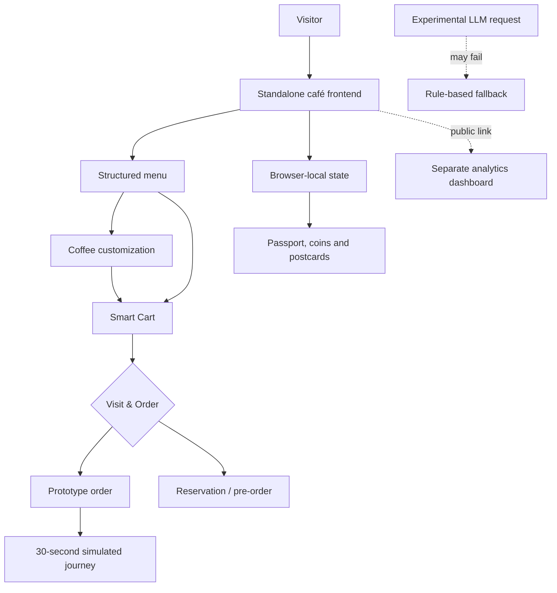

<div align="center">


### ☕ A little altitude. A lot of atmosphere.

**An interactive, Mussoorie-inspired café experience — built, broken, tested and refined with AI assistance.**

[](https://mist-and-mug.onrender.com/) [](https://mist-mug-dashboard.onrender.com/)

   

**[THE STORY](#the-story) · [EXPLORE](#choose-your-own-café-adventure) · [ARCHITECTURE](#under-the-hood) · [THE BUG DIARY](#the-bug-diary) · [DEMO DAY](#the-4-minute-judge-tour)**

</div>

---

<a id="the-story"></a>
## 01 / The story behind the steam

> **What if opening a café website felt like arriving at a window seat above the clouds?**

Most café websites show you a menu. **Mist & Mug tries to give you a moment.** The mountains set the scene. The menu lets you explore. Coffee customization makes the experience personal. A cart, optional reservation journey, postcards, games and music turn a simple webpage into a little digital café.

But this is also a computer science project: **we used AI-assisted development, challenged its output, found problems, and learned to repair them.** The finished interface matters. So does knowing what happens when something fails.

<table>
<tr><td width="33%"><b>01 · ATMOSPHERE</b><br/>Mountain-led visuals, Weather Window and Café Mood.</td><td width="33%"><b>02 · PERSONALIZATION</b><br/>Build Your Own Coffee and a structured menu.</td><td width="33%"><b>03 · EXPERIENCE</b><br/>Smart Cart, reservations, Passport and playful discoveries.</td></tr>
</table>

<a id="choose-your-own-café-adventure"></a>
## 02 / Choose your own café adventure

*This README is interactive in the GitHub-native way: open the chapters you care about, follow the live links, and explore the architecture.*

<details open>
<summary><b>☕ I came for the coffee — explore the menu and custom builder</b></summary>

<br/>

**Browse → Customize → Add to cart.** Explore the existing menu, open product details and create a personal brew with base drink, milk, strength, sweetness and temperature. Different configurations can be represented as distinct cart entries.

**Try it:** [Open the café](https://mist-and-mug.onrender.com/) and navigate to **Menu → Build Your Own Coffee**.

</details>

<details>
<summary><b>🧾 I want to see the complete customer journey</b></summary>

<br/>

**Menu → Smart Cart → Visit & Order → Prototype confirmation.** Visitors can explore ordering and table reservation choices. The 30-second **Received → Brewing → Ready** journey is a clearly simulated animation, not live kitchen tracking.

**Try it:** [Open the café](https://mist-and-mug.onrender.com/) and look for **Visit & Order**.

</details>

<details>
<summary><b>🏔️ I'm here for the mountain atmosphere</b></summary>

<br/>

The mountain hero, Weather Window, postcards and visual moods make the setting part of the interaction. Optional browser-generated instrumental ambience lets visitors choose their own pace.

**Try it:** [Visit Mist & Mug](https://mist-and-mug.onrender.com/) and explore **Café Mood** and **Postcards**.

</details>

<details>
<summary><b>🎮 Show me the playful side</b></summary>

<br/>

Bean Drop, Cloud Coins and Cloud Passport reward exploration. Their state is browser-local: these are playful prototype mechanics, not secure or redeemable currency.

</details>

<details>
<summary><b>📊 I'm curious about the management dashboard</b></summary>

<br/>

The dashboard is a **separately deployed application**. The café's Admin entry is a **demo navigation flow**, not a secure sign-in system; it does not authenticate visitors or automatically synchronize sales data.

**Explore:** [Mist & Mug Dashboard](https://mist-mug-dashboard.onrender.com/)

</details>

---

<a id="under-the-hood"></a>
## 03 / Under the hood



| Part | Technology / approach | Boundary to understand |
|:--|:--|:--|
| Frontend | Standalone HTML, CSS and JavaScript | Responsive behavior needs real-browser testing. |
| Images | Embedded / linked assets | Original resolution limits visual sharpness. |
| Personalization | Menu data and client-side logic | Prices and product facts should come from structured data. |
| Cart / reservations | Browser-local prototype flows | No payment, staff dispatch or shared booking inventory. |
| Games / rewards | Browser-local state | Users can reset or edit local progress. |
| AI experiments | LLM requests with rule-based fallback | Live model inference is **not guaranteed** in the standalone build. |
| Dashboard | Separate Render app | No automatic data sync is claimed. |

<details>
<summary><b>🤖 Is Mist & Mug really AI-powered?</b></summary>

<br/>

**AI-assisted development** and **live AI inference** are different claims. The project used AI tools during development and explored model-based recommendations. Direct browser calls can fail, so the standalone build retains deterministic fallback logic. The visible quiz and voice-ordering features were later removed by choice. A secure backend would be needed for reliable authenticated LLM requests.

**Design principle:** A model may recommend; trusted structured menu data must define prices, ingredients and dietary facts.

</details>

---

<a id="the-bug-diary"></a>
## 04 / The bug diary: where the learning happened

**A pretty screenshot wasn't the finish line.** Here are five real development problems that shaped the project.

<details open>
<summary><b>01 · The reservation reached Review… and showed nothing</b></summary>

<br/>

**Symptom:** The multi-step Misty reservation flow sometimes reached a blank Review screen or failed to advance.

**Lesson:** A valid-looking interface isn't enough. State transitions, missing values and the final confirmation path need end-to-end checks.

**Evidence to present:** Before/after Review screenshots and a successful reservation walkthrough.

</details>

<details>
<summary><b>02 · The images looked right locally, then broke on Render</b></summary>

<br/>

**Symptom:** Product or landscape images failed to load after deployment; some available images were too low-resolution for large display containers.

**Lesson:** Production paths, embedded assets, original pixel dimensions and `object-fit` are all part of visual quality.

**Evidence to present:** Browser Network tab and before/after image screenshots.

</details>

<details>
<summary><b>03 · A confirmed order appeared inside an empty cart</b></summary>

<br/>

**Symptom:** After placing a prototype order, the cart cleared while the confirmation message remained in the wrong view.

**Lesson:** Capture a receipt snapshot **before** clearing mutable cart state; confirmation deserves its own UI state.

**Evidence to present:** The empty-cart bug and the updated receipt screen.

</details>

<details>
<summary><b>04 · Live weather suggestions couldn't reach their API</b></summary>

<br/>

**Symptom:** The weather-based recommendation panel sometimes showed an unavailable message.

**Lesson:** External services need timeouts, fallback behavior and honest error messages. The weather suggestion feature was ultimately removed at the creator's request.

**Evidence to present:** Failure-state screenshot and the decision to remove an unreliable feature.

</details>

<details>
<summary><b>05 · The Admin page looked like login, but wasn't authentication</b></summary>

<br/>

**Symptom:** A branded sign-in demo redirected to a separate public dashboard; the ChatGPT preview also showed an external-link confirmation.

**Lesson:** A frontend-only form cannot protect another website. Secure authentication requires enforcement by the dashboard application or its backend.

**Evidence to present:** Explain the difference between a demonstration and real access control.

</details>

> **Assessment note:** These are development-history examples. Do not describe every issue as fully regression-tested without current evidence. The CS-1 rubric rewards **finding, diagnosing and correcting** AI-generated mistakes.

---

<a id="the-4-minute-judge-tour"></a>
## 05 / The 4-minute judge tour

| Time | What to show | What to say |
|:--|:--|:--|
| **00:00** | Homepage hero | “We wanted the website to feel like Mussoorie before you read the menu.” |
| **00:30** | Menu and details | “Product information comes from structured data.” |
| **01:00** | Build Your Own Coffee | “Options update the drink and its cart entry.” |
| **01:40** | Visit & Order | “Ordering and reservations share one entry point.” |
| **02:20** | Order Journey | “This is a 30-second simulation, not a real kitchen feed.” |
| **02:45** | Passport / postcards | “We made exploration part of the experience.” |
| **03:15** | One bug and its fix | “Here is where AI-generated code failed and how we investigated.” |
| **03:45** | Limitations | “We distinguish a working prototype from a production system.” |

<details>
<summary><b>🎤 Judge asks: “Did AI make this entire website?”</b></summary>

<br/>

AI tools helped generate and revise code. The project work includes choosing the concept, specifying behavior, integrating features, investigating bugs, testing results and understanding limitations. We don't claim every line was handwritten.

</details>

<details>
<summary><b>🎤 Judge asks: “Can a customer really pay or reserve?”</b></summary>

<br/>

No. These are browser-local demonstration flows. A real café would need server-side order records, verified payments, availability management and staff confirmations.

</details>

<details>
<summary><b>🎤 Judge asks: “What was the hardest engineering lesson?”</b></summary>

<br/>

The hardest part wasn't adding features. It was making multiple stateful features coexist without breaking each other, especially reservations, cart confirmation, responsive overlays and deployment assets.

</details>

---

## 06 / Run the standalone café

Save the standalone website as `index.html`, then run:

```bash
python -m http.server 8000
```

Open **http://localhost:8000**. No npm installation is needed for the standalone café HTML. The separate dashboard is a different project with its own setup.

<details>
<summary><b>🧪 Open the pre-demo checklist</b></summary>

<br/>

- [ ] Homepage opens at the hero without jumping.
- [ ] Menu photos load and item drawers work.
- [ ] Coffee customizations produce the intended cart items.
- [ ] Cart quantities, totals and receipt are consistent.
- [ ] Reservation and pre-order journeys reach confirmation.
- [ ] The 30-second order tracker is clearly labelled as simulated.
- [ ] Postcard and Passport states behave as described.
- [ ] Café Mood audio starts and stops correctly.
- [ ] The Admin demo never claims secure authentication.
- [ ] No overlap or horizontal overflow at 390, 768, 862, 1366 and 1920px.

</details>

## 07 / What's real, what's simulated

| Visitor-facing experience | Reality |
|:--|:--|
| Order placed | Browser-local demo order; no payment or café dispatch. |
| Brewing / ready | Timer-based simulation. |
| Table booking | Prototype reservation; no shared live availability. |
| Cloud Coins | Browser-local points, not secure currency. |
| Admin sign-in | Presentation-only flow; **do not enter real passwords**. |
| AI recommendations | Experimental LLM path with rule-based fallback; not guaranteed live. |
| Analytics dashboard | Separately hosted; not automatically synchronized with local café activity. |

---

<div align="center">

### The best projects aren't the ones that never break.
### They're the ones whose builders know *why* they broke.

**MIST & MUG**  
*Made for the mountains. Built to be questioned.*

[](https://mist-and-mug.onrender.com/)

<sub>Mussoorie-inspired concept café · AI-assisted student project · Educational demonstration</sub>

</div>
