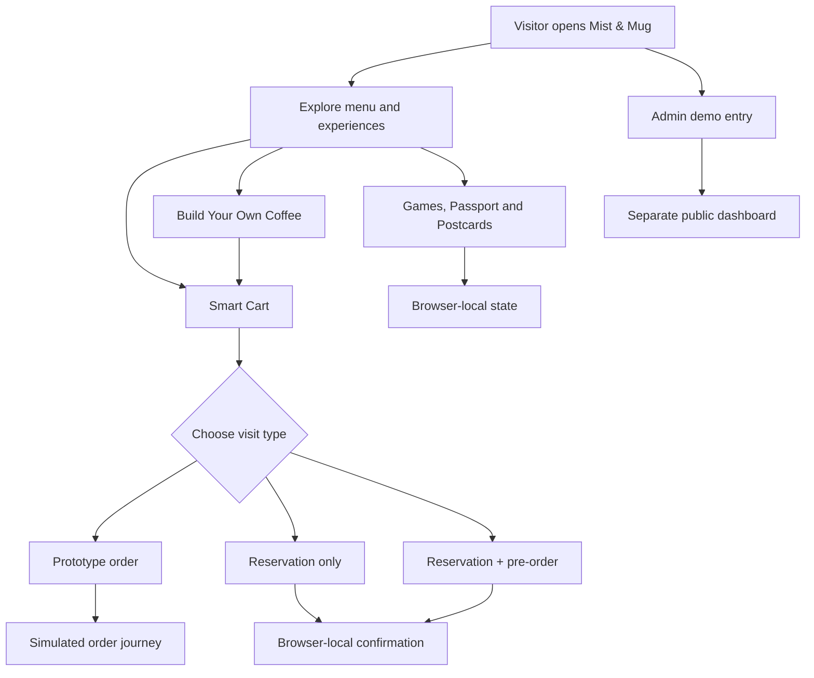

<div align="center">

# MIST & MUG
### *A little altitude. A lot of atmosphere.*

**A Mussoorie-inspired digital café experience**  
*Designed to feel like a place, not just a webpage.*

[](https://mist-and-mug.onrender.com/)
[](https://mist-mug-dashboard.onrender.com/)


**[Enter the café](https://mist-and-mug.onrender.com/) · [Explore the dashboard](https://mist-mug-dashboard.onrender.com/)**

</div>

---

> **“We saved you the window seat.”**
>
> Mist & Mug is a fictional café concept inspired by Mussoorie's clouds, quiet corners, mountain views and slow coffee rituals. The goal was never to build another generic restaurant landing page. It was to build an experience visitors want to explore.

## 01 / The idea

Most café websites answer three questions: *What's on the menu? Where are you? How do I order?*

Mist & Mug asks one more: **How do you want to feel when you get here?**

That question shaped the design: a cinematic mountain opening, a considered menu, small discoveries, personal coffee customization, an optional reservation flow, and playful moments that reward exploration.

**This is an AI-assisted student project.** The important engineering work includes testing generated code, correcting defects, understanding the limits of browser-only storage, and distinguishing genuine AI calls from deterministic recommendations.

## 02 / The experience, in one glance

| The moment | What visitors can do |
|:--|:--|
| **Arrive** | Explore the mountain-inspired homepage and café story. |
| **Discover** | Browse the menu, filters, item information and coffee flavour experiences. |
| **Personalize** | Build a coffee with selectable base, milk, strength, sweetness and temperature. |
| **Order** | Add items to the Smart Cart, adjust quantities and place a **prototype order**. |
| **Plan a visit** | Use the Misty reservation flow, optionally attaching a pre-order. |
| **Follow along** | Watch a **simulated 30-second** order journey. |
| **Stay a little** | Explore postcards, Cloud Passport, Cloud Coins, Bean Drop and Café Mood music. |
| **Look behind the counter** | Open the separate analytics dashboard from the Admin entry. |

The experience deliberately keeps ordering, reservation and playful exploration in a coherent visual language rather than treating each feature as a disconnected demo.

## 03 / A few signature details

### ☕ Your coffee, your call
The **Build Your Own Coffee** experience lets a visitor choose a drink and personalize it. The selected options and price become a distinct cart item, so two differently configured coffees can be kept separate.

### 🪟 The window seat
The mountain atmosphere is part of the interface, not just a decorative header. The existing Weather Window and visual modes contribute to the café's sense of place.

### ✉️ A postcard from the hills
The postcard experience gives visitors a small creative souvenir. Cloud Coins and Passport elements add a lightweight progression system. These rewards are browser-local and are not redeemable monetary value.

### 🎵 Stay for the ambience
Café Mood offers visual themes and browser-generated instrumental ambience. Playback is optional and controlled by the visitor.

### 🧾 From cart to cup
The order journey presents **Received → Brewing → Ready** on a 30-second *simulation*. It is a presentation of the customer experience, **not** a real kitchen-status feed.

## 04 / How it works



**Current architecture:** a standalone frontend built primarily with HTML, CSS and JavaScript, with embedded image assets and browser `localStorage` for several demo features. The analytics dashboard is a **separate deployed application**; the café website does not automatically synchronize its local orders with dashboard sales data.

### AI: what is real, and what is fallback?

The project has experimented with LLM-based recommendations and rule-based matching. In the standalone version, direct browser-side LLM calls can fail due to provider/network restrictions, so a **deterministic fallback** is retained. The current user-facing quiz is hidden in this version.

**We do not claim that all recommendations are generated by a live LLM.** Product prices, allergens and menu facts should come from structured menu data, not model improvisation.

## 05 / Run it locally

This version is intentionally simple to inspect.

1. Save the latest standalone website file as **`index.html`**.
2. Open it in a modern browser, or serve it locally for more consistent browser behavior:

```bash
python -m http.server 8000
```

3. Visit `http://localhost:8000`.

No `npm install` is required for the standalone café page. The **separate dashboard repository** has its own dependencies and setup.

> Some browser capabilities and external requests may behave differently in local files, embedded previews and Render. Always verify the deployed version separately.

## 06 / What we learned by breaking it

The project followed a **build → test → critique → repair** loop. Several concrete issues appeared during development:

| What went wrong | What we learned / changed |
|:--|:--|
| Reservation Review sometimes appeared blank or failed to advance. | Multi-step UI state must be validated end-to-end, not just by checking syntax. |
| Embedded images looked soft or loaded incorrectly after deployment. | Asset paths, original resolution and responsive cropping all matter. |
| Cart confirmation appeared in an empty-cart view. | Order confirmation must capture items before cart state resets. |
| Weather-based suggestions failed when a live request was unavailable. | External APIs need honest fallback states; the feature was later removed at the creator's request. |
| Admin navigation appeared to require login but merely redirected. | A demo form is **not authentication**. Access control belongs to the dashboard/server, not a public HTML form. |
| Tablet-width overlays, badges and floating controls competed for space. | Responsive QA must cover awkward intermediate widths, not only mobile and desktop presets. |

**Important:** These are documented development problems and remediation directions, not a claim that every browser-level regression has been fully verified.

## 07 / Demo route for judges

A short walkthrough that demonstrates both product thinking and engineering:

**00:00 — First impression.** Open the homepage and explain the Mussoorie-inspired design language.

**00:30 — Product discovery.** Browse the menu and show the item information.

**01:00 — Personalization.** Customize a coffee, add it to the cart and explain how the options affect the item.

**01:45 — Customer flow.** Demonstrate Visit & Order and the reservation/pre-order choices.

**02:30 — Beyond checkout.** Show the simulated Order Journey, Passport or Postcard.

**03:00 — Engineering critique.** Explain one bug you found, its root cause, the fix, and how you tested it.

**03:45 — Boundaries.** Clearly distinguish browser-local prototypes from real payments, staff bookings, authenticated admin access and live AI.

*Tip: a well-explained limitation is stronger than an unverified feature claim.*

## 08 / What this project is — and isn't

| Included in this prototype | Not claimed |
|:--|:--|
| Interactive café frontend | A production commerce platform |
| Browser-local cart and reservations | Orders delivered to café staff |
| Simulated order tracking | Live kitchen integration |
| Browser-local rewards | Fraud-resistant loyalty currency |
| Demo Admin entry | Secure administrator authentication |
| Rule-based fallback for recommendations | Guaranteed live LLM inference |
| Separate analytics dashboard link | Automatically synchronized business data |

The demo Admin form accepts nonempty fields to continue; it **does not validate credentials**. Do not enter a real password. If the dashboard ever contains private data, enforce authentication in the dashboard application itself.

## 09 / Design and engineering principles

**Atmosphere without friction.** Keep the mountain photography and typography central; don't add effects that block reading or navigation.

**One journey, not ten popups.** Reuse the existing Visit & Order and Café Mood entry points rather than scattering controls across the viewport.

**Graceful failure.** A failed API call should not destroy the page or silently fabricate a live result.

**Truthful prototypes.** A demo order is a demo order; a local reward is not secure currency; a public dashboard link is not an admin session.

**Reversible improvements.** Make focused changes, preserve backups, and regression-test the flows most likely to break.

## 10 / What's next

- Complete responsive and accessibility regression testing.
- Verify the live deployment's image quality, keyboard navigation and interactions.
- Document and test the separate dashboard independently.
- Add genuine server-side AI only if the project needs it, with secret management and clear trust boundaries.
- Move orders, reservations and rewards to trusted storage **before** using them for a real business.

---

<div align="center">

### Made for the mountains. Built to be questioned.

**MIST & MUG**  
*A student-built, AI-assisted café experience inspired by Mussoorie.*

[**Visit the café**](https://mist-and-mug.onrender.com/) · [**Open the dashboard**](https://mist-mug-dashboard.onrender.com/)

<sub>Concept café · Educational prototype · Not a real ordering or reservation service</sub>

</div>
