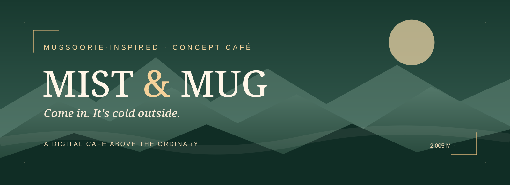
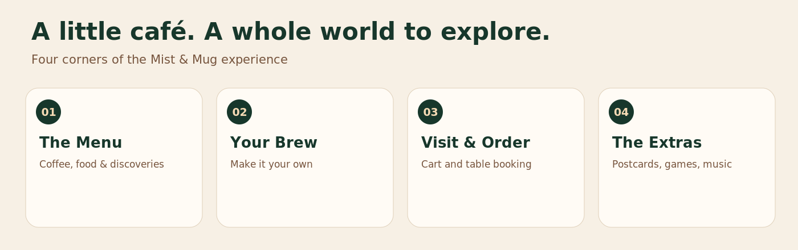
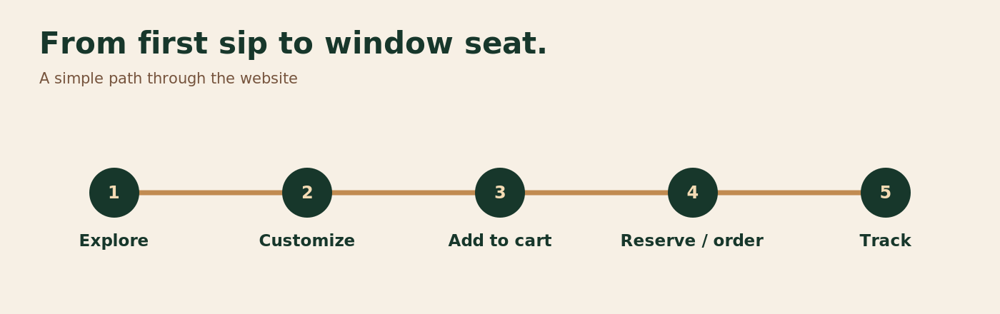
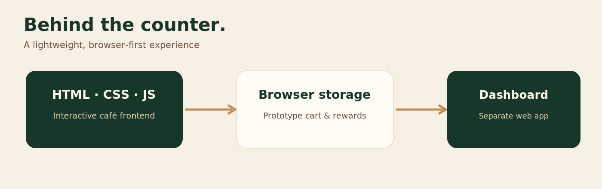

# MIST & MUG

### *Come in. It’s cold outside.*

A cozy little digital café inspired by the misty hills of Mussoorie.  
**Pick a cup. Find a corner. Stay a while.**

[**☕ STEP INSIDE**](https://mist-and-mug.onrender.com/) &nbsp; · &nbsp; [**↗ EXPLORE THE DASHBOARD**](https://mist-mug-dashboard.onrender.com/)

---

### Your next coffee break, but make it interactive.

<table>
<tr>
<td width="50%" align="center"><h3>☕ Make your own cup</h3>
Choose a base, milk, strength, sweetness and serving temperature.
</td>
<td width="50%" align="center"><h3>🪟 Save your window seat</h3>
Explore the reservation flow — with an optional food pre-order.
</td>
</tr>
<tr>
<td align="center"><h3>✉️ Take the mountains home</h3>
Create a postcard and explore the Cloud Passport and rewards.
</td>
<td align="center"><h3>🎵 Set the mood</h3>
Switch café atmospheres, enjoy optional music and try Bean Drop.
</td>
</tr>
</table>

---

**Browse → Customize → Add to Cart → Choose Your Visit → Follow the Journey**

The order tracker is a **30-second simulation**, designed to show the experience — not real kitchen updates.

---

## Choose your corner

<b>☕ I’m here for the coffee</b>

Explore the menu, compare flavours, and use **Build Your Own Coffee** to create a personal brew. Different customizations remain distinct in the Smart Cart.

<b>🪟 I want to plan a visit</b>

Open **Visit & Order** to browse the cart, reserve a table, or combine a reservation with a pre-order. These are browser-based prototype flows, not bookings sent to café staff.

<b>🌄 I’m just exploring</b>

Try the mountain atmosphere, postcards, Cloud Coins, Cloud Passport, Bean Drop and Café Mood. There’s no rush.

---

### Built to feel effortless.

**HTML · CSS · JavaScript** for the café experience.  
**Browser storage** for several interactive prototype features.  
**Separate dashboard** for the management-style experience.

> **A note about the prototype:** Mist & Mug is a fictional, educational café concept. Orders, reservations, reward coins and order progress are not connected to a real café. The Admin entry is a demonstration interface, not secure authentication. Live AI requests are not guaranteed; some recommendation logic uses deterministic fallbacks.

---

### Curious? The best way to understand Mist & Mug is to visit.

[**ENTER MIST & MUG →**](https://mist-and-mug.onrender.com/)

*Made for slow mornings, mountain weather, and one more cup.*

