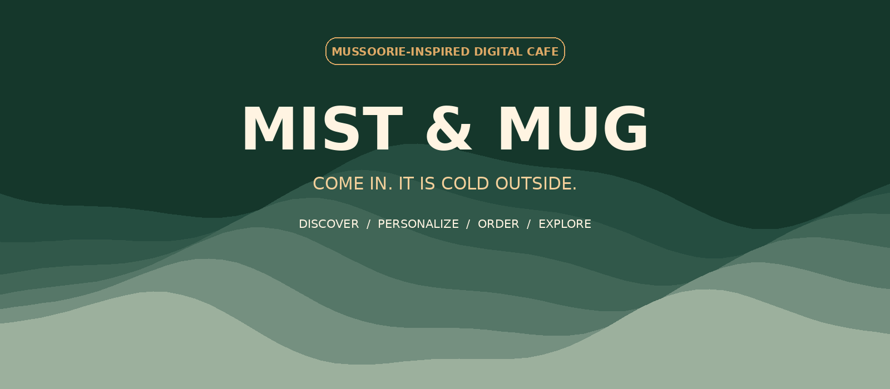
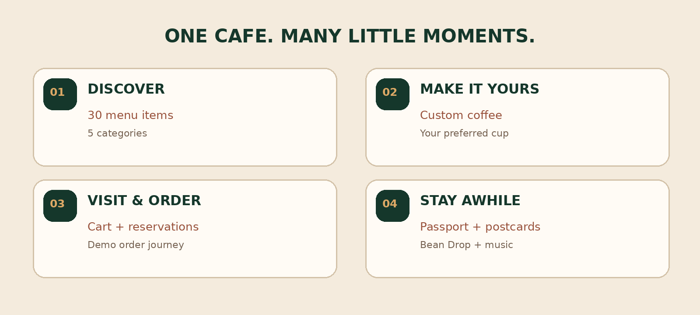
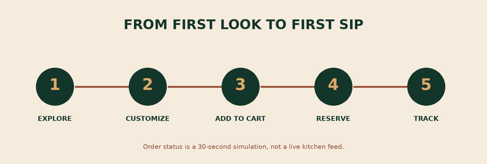
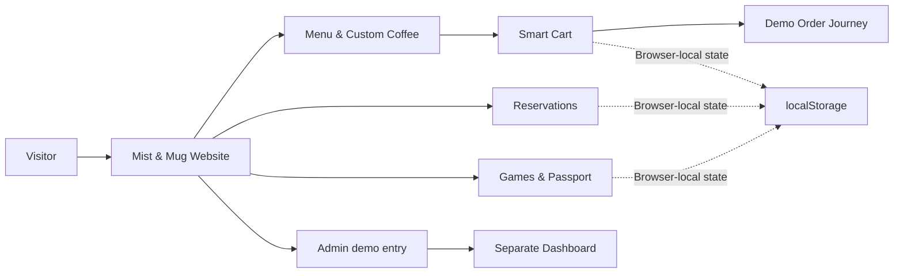
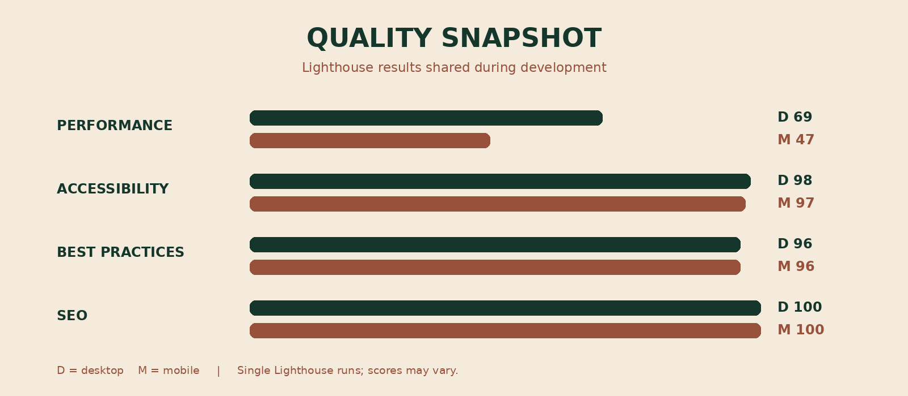

<div align="center">



# MIST & MUG
### *Come in. It's cold outside.*

A Mussoorie-inspired digital café you can explore from anywhere.

[**☕ ENTER THE CAFÉ**](https://mist-and-mug.onrender.com/) &nbsp; · &nbsp; [**📊 EXPLORE THE DASHBOARD**](https://mist-mug-dashboard.onrender.com/)


**A little altitude. A lot of atmosphere.**

</div>

---

## Your window seat is waiting.

A mountain view. Something warm in your hands. A menu made for slow mornings.

Mist & Mug brings that feeling to the browser—through a curated menu, personalized coffee, interactive ordering, and little moments worth staying for.



<div align="center">

### [OPEN THE LIVE EXPERIENCE →](https://mist-and-mug.onrender.com/)

</div>

## Take the scenic route



<details>
<summary><b>01 / Explore the menu</b> — see what's brewing</summary>

Browse **30 products across five categories** in the tested catalogue. Search, filter by preferences, and open product details for descriptions and dietary information.

</details>

<details>
<summary><b>02 / Build your coffee</b> — make it yours</summary>

Customize a coffee's base, milk, espresso strength, syrup, and serving temperature. The cart retains the chosen configuration and calculated demo price.

</details>

<details>
<summary><b>03 / Visit & Order</b> — choose your journey</summary>

Add items to the cart, adjust quantities, choose a reservation, or combine a reservation with a pre-order. The checkout and reservation flows are **prototype experiences**, not transactions sent to a café.

</details>

<details>
<summary><b>04 / Track the moment</b> — from received to ready</summary>

The 30-second Order Journey animates three stages: **Received → Brewing → Ready**. This timeline is simulated; it does not report real kitchen activity.

</details>

<details>
<summary><b>05 / Discover the extras</b> — there's more around the corner</summary>

Try **Café Mood** themes and original instrumental ambience, collect browser-local **Cloud Passport** stamps, explore **Cloud Coins**, play **Bean Drop**, or make a mountain postcard.

</details>

---

## The little details

| ☕ The personal brew | 🪟 Mountain atmosphere | ✉️ Postcards | 🎮 Bean Drop |
|:--|:--|:--|:--|
| Choose what goes into your cup. | Explore the Weather Window and changing moods. | Create a shareable mountain-inspired keepsake. | Take a playful break between coffees. |

> **A note about the experience:** Mist & Mug is a fictional concept café. The cart, reservations, loyalty rewards, and order tracking are demonstrations. No payment is taken and no order is sent to a real café.

## A peek behind the counter

The café website is built as a **standalone HTML, CSS and JavaScript experience**, with photographs embedded in the current safe deployment version. Several interactive states use browser `localStorage`.

The analytics dashboard is a **separate application**, linked from the Admin entry. The demo Admin form is a presentation flow, **not secure authentication**.



### What about AI?

Mist & Mug has explored AI-assisted recommendations, but the standalone browser version does **not** promise a working live LLM connection. Where recommendation logic is available, deterministic rules provide the fallback. The previously used Find My Cup quiz is hidden in the current visitor experience.

## Quality, measured—not invented



These scores were shared from Lighthouse runs during development, not continuous monitoring. The latest reported scores were **Desktop: 69 performance, 98 accessibility, 96 best practices, 100 SEO** and **Mobile: 47 performance, 97 accessibility, 96 best practices, 100 SEO**. Scores can change with device, network, caching and hosting conditions.

<details>
<summary><b>What is being improved?</b></summary>

- Desktop and mobile loading performance.
- Image loading without broken asset paths.
- Responsive spacing around floating controls.
- Browser interaction reliability and accessibility.

The current safe standalone version keeps photographs embedded to avoid missing assets when deploying only `index.html`. That reliability trade-off can increase initial document size.

</details>

## Want to run the café page yourself?

The standalone website needs no framework build.

```bash
# Place the standalone website in a folder as index.html
python3 -m http.server 8000
# Open http://localhost:8000
```

The separate dashboard has its own source repository, build tools, and deployment process.

## Explore

<div align="center">

| **The café** | **Behind the counter** |
|:--:|:--:|
| [**Visit Mist & Mug →**](https://mist-and-mug.onrender.com/) | [**Open the dashboard →**](https://mist-mug-dashboard.onrender.com/) |
| Menu · Coffee · Cart · Experiences | Analytics · Catalogue · Insights |

### Made for the mountains. Built for curious people.

*We saved you the window seat.*

</div>
