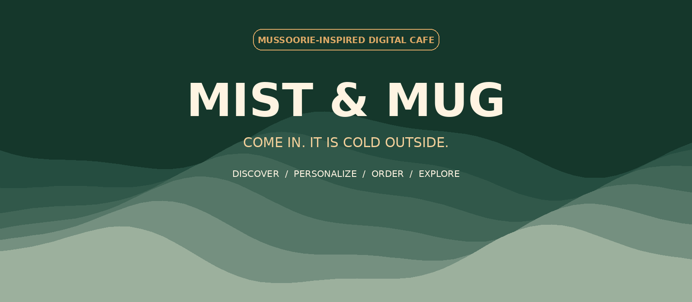
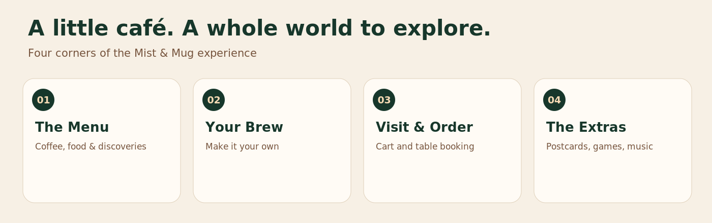
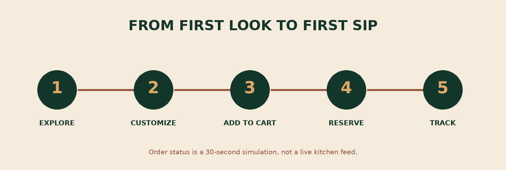
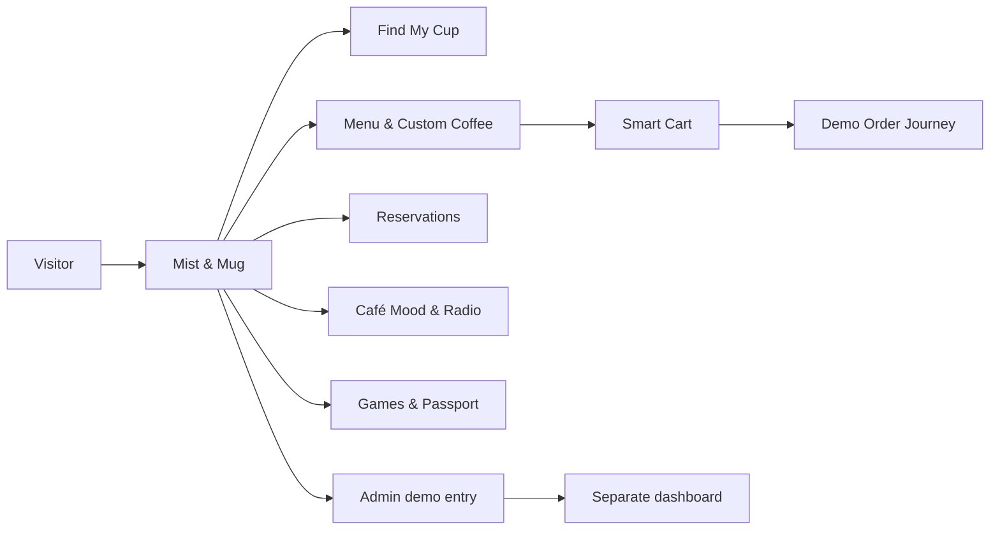
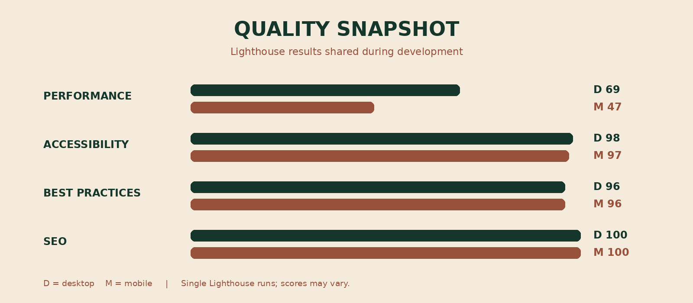

<div align="center">



# MIST & MUG
### *Come in. It's cold outside.*

**A little altitude. A lot of atmosphere.**

[](https://mist-and-mug.onrender.com/)
[](https://mist-mug-dashboard.onrender.com/)

*A Mussoorie-inspired digital café, made for the curious.*

</div>

---

## Welcome to your window seat.

Mist & Mug is more than a menu. It's a place to discover your next cup, build it exactly how you like, explore the hills, and stay for a little music.



| **Find your cup** | **Make it yours** | **Stay awhile** |
|:--|:--|:--|
| A four-question drink matcher | Custom coffee, cart and demo ordering | Café Radio, Passport, postcards and Bean Drop |

## Your journey through the café



<details>
<summary><b>01 — Find My Cup · Your taste, your match</b></summary>

Answer four short preference questions and receive a drink recommendation, a food pairing, and an explanation. The current experience uses **rule-based matching with structured menu information**, not a live LLM connection.

</details>

<details>
<summary><b>02 — Build Your Own Coffee · A cup that's yours</b></summary>

Choose a coffee base, milk, strength, syrup and serving temperature. Add your personalized drink to the cart with its selected options and calculated demo price.

</details>

<details>
<summary><b>03 — Visit & Order · A smooth customer journey</b></summary>

Browse menu categories, search and filter items, view ingredients and dietary information, adjust cart quantities, and place a **simulated order**. Follow the 30-second **Received → Brewing → Ready** journey, or try the table reservation flow.

</details>

<details>
<summary><b>04 — Café Mood & Mist & Mug Radio · Sounds better above the clouds</b></summary>

The current Radio experience lives inside **Café Mood** and offers:

- Three original browser-synthesized instrumental melodies.
- Play, pause/resume, previous and next track.
- A seekable progress slider and volume controls.
- Optional synthesized rain ambience with independent volume.
- A scrollable panel that keeps the existing mood choices accessible.

Playback is opt-in. **The six proposed licensed jazz recordings are not integrated**; the Radio currently uses synthesized audio. Listening quality and all browser behaviors have not been independently verified.

</details>

<details>
<summary><b>05 — Small discoveries · Passport, postcards and play</b></summary>

Explore Cloud Passport stamps, browser-local Cloud Coins, the Bean Drop mini-game, Winterline, weather-themed visuals and a postcard maker. Some rewards and progress are stored locally in your browser.

</details>

---

## A look under the hood



**Built with:** HTML, CSS and JavaScript for the standalone café website; browser `localStorage` for several demo states; Web Audio API for synthesized music and rain. Hosted on Render Static Site. The analytics dashboard is a separate deployed application.

> **Prototype transparency:** Mist & Mug is a fictional educational café. Orders, tracking, reservations and loyalty rewards are demonstrations. No real payment is collected or order transmitted to a café. The Admin form is a demo entry, not secure authentication.

## Quality, measured



Three consecutive desktop Lighthouse runs reported:

| Category | Run 1 | Run 2 | Run 3 |
|:--|--:|--:|--:|
| Performance | 76 | 74 | 74 |
| Accessibility | 98 | 98 | 98 |
| Best Practices | 96 | 96 | 96 |
| SEO | 100 | 100 | 100 |

**Desktop performance median: 74/100.** These are laboratory estimates from user-run audits, not guaranteed real-user scores. The last reported mobile performance score was **47/100** on an earlier build.

## Explore the live project

<div align="center">

### [☕ Step inside Mist & Mug](https://mist-and-mug.onrender.com/)

[**See the separate café dashboard**](https://mist-mug-dashboard.onrender.com/)

*We saved you the window seat.*

</div>

---

<details>
<summary><b>Run the standalone website locally</b></summary>

Save the standalone site as `index.html`, then from its directory:

```bash
python3 -m http.server 8000
```

Open `http://localhost:8000`. The current safe standalone version embeds its photography inside the HTML, so it does not require a separate image folder for the café photographs. This README's four PNG graphics are separate files used for GitHub presentation only.

</details>

<sub>Last documentation update: November 2026 · Radio feature described from the latest deployed-version discussion; full live browser verification remains separate.</sub>
